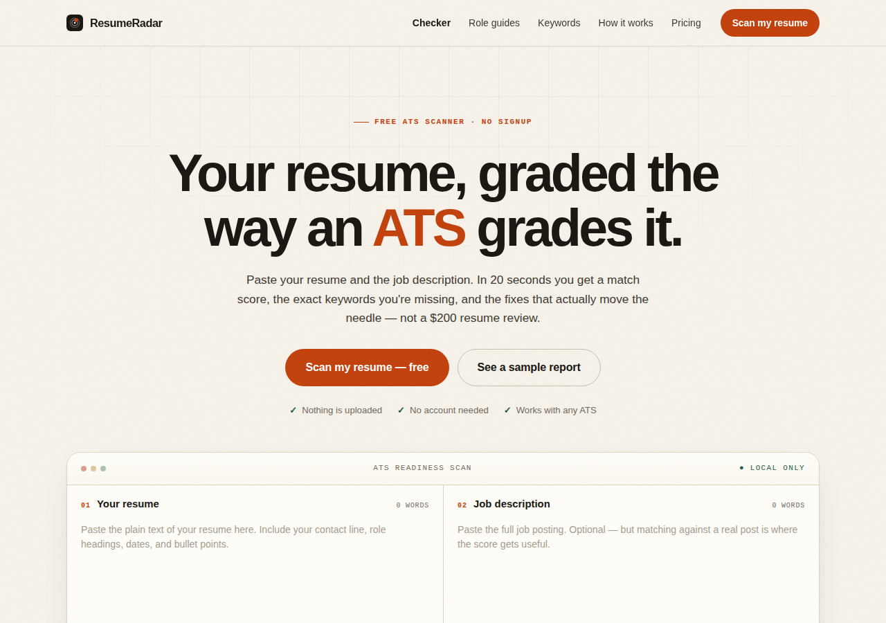

# ResumeRadar

A private, client-side ATS resume checker with a one-time Pro unlock. No server, no AI API, no account system, no database.

**Live site:** <https://automatethebs.github.io/resume-radar/>  
**Price:** $9 one-time  
**Payments:** USDC on Base out of the box, verified in the buyer's browser. Card checkout via Stripe can be enabled in one config file.



---

## Why this can make money

- **Real willingness to pay.** Job seekers already pay $50–$300 for resume reviews and $20–$50/month for resume builders. A $9 one-time gap report is an easy yes compared with another month of applications that go nowhere.
- **Zero marginal cost.** Scoring runs as deterministic JavaScript in the browser. There is no inference bill, no server, and no per-scan cost. Every sale is almost pure margin.
- **Privacy is the differentiator.** The resume never leaves the device. That is a credible claim because there is no upload endpoint at all.
- **Built-in distribution surface.** The build generates 39 role-specific landing pages, a guide hub, a sitemap, FAQ schema, canonical URLs, and copyable keyword lists. Those pages target long-tail searches such as "ATS resume checker for nurses" and "software engineer resume keywords".
- **No payment account required to start.** The default USDC checkout is self-custody and verified on-chain. A Stripe Payment Link can be added later for card buyers.

Revenue still requires traffic. The code removes the infrastructure and payment-setup excuses; it cannot remove the need to distribute the product. See [PLAYBOOK.md](PLAYBOOK.md) for the launch plan and realistic math.

---

## What it does

1. Paste a resume and, optionally, a real job description.
2. Pick one of 39 roles or let the job description drive keyword extraction.
3. Get a 0–100 ATS readiness score with four category scores:
   - **Keyword match — 40%**: job-description coverage plus role-checklist coverage, with synonym and partial matching.
   - **Parser-safe structure — 20%**: contact details, standard section headings, date ranges, bullet density, and obvious formatting risks.
   - **Measurable impact — 25%**: quantified bullets, action verbs, weak phrases, and outcome density.
   - **Readability — 15%**: sentence/word length, bullet length, passive voice, and filler.
4. Free users see the score, category breakdown, top five missing keywords, and top four fixes.
5. Pro reveals every missing keyword, the full role checklist, every fix, and a downloadable `.txt` report.

All analysis is deterministic. The same input produces the same output, which makes the engine testable and the result explainable. There is no "AI score" hiding behind a random number.

---

## Quick start

```bash
cd resume-radar
npm test          # builds the SEO layer and runs 38 tests
npm run serve     # http://127.0.0.1:4173
```

No `npm install` is required. The project has zero runtime dependencies.

Useful commands:

```bash
npm run build     # regenerate role pages, roles.html, sitemap.xml, robots.txt
npm test          # build + tests
npm run serve     # zero-dependency static preview
npm run deploy    # Cloudflare Pages deploy (needs wrangler auth)
```

To build with a different canonical domain:

```bash
SITE_URL=https://yourdomain.com npm run build
```

The site is served from `site/`. Everything else is source, tests, and documentation.

---

## Project layout

```
resume-radar/
├── site/
│   ├── index.html                 landing page + live scanner
│   ├── free-ats-resume-checker.html  high-intent landing page
│   ├── sample-report.html         illustrative score/report example
│   ├── pricing.html               Free vs Pro, payment FAQ
│   ├── how-it-works.html          methodology and ATS explainer
│   ├── roles.html                 generated role directory
│   ├── roles/*.html               39 generated role landing pages
│   ├── guides.html                generated guide hub
│   ├── jobscan-alternative.html   honest ResumeRadar vs Jobscan comparison
│   ├── ats-resume-format.html     formatting guide
│   ├── free-ats-resume-template.html  copy/download/print template
│   ├── resume-action-verbs.html   200+ verb library
│   ├── resume-summary-examples.html  generated summaries for 39 roles
│   ├── resume-summary-generator.html free summary generator
│   ├── keyword-extractor.html     free job-posting keyword tool
│   ├── web3.html                  crypto/Web3 landing page
│   ├── pay-with-usdc.html         payment guide
│   ├── privacy.html               privacy policy
│   ├── terms.html                 terms and refund policy
│   ├── 404.html
│   ├── assets/
│   │   ├── engine.js              scoring engine (no DOM, testable)
│   │   ├── roles.js               39 role keyword libraries
│   │   ├── app.js                 scanner UI and report rendering
│   │   ├── site.js                nav, Pro unlock, payment dialogs
│   │   ├── template.js            copy/download/print controls
│   │   ├── summary.js             local summary generator
│   │   ├── payments.js            client-side USDC receipt verification
│   │   ├── config.js              the only file you edit to run the business
│   │   ├── styles.css             complete responsive/print design system
│   │   ├── og.png                 1200×630 social card
│   │   └── usdc-qr.svg            QR code for the payment address
│   ├── sitemap.xml                generated
│   └── robots.txt                 generated
├── scripts/
│   ├── build.mjs                  static SEO generation
│   ├── indexnow.mjs               submit all sitemap URLs
│   └── serve.mjs                  zero-dependency preview server
├── tests/
│   ├── engine.test.cjs            scoring behavior
│   ├── payments.test.cjs          USDC verification behavior
│   └── site.test.cjs              generated-site integrity
├── .github/workflows/pages.yml    GitHub Pages deployment
├── .secrets/                      gitignored; self-custody wallet lives here
├── PLAYBOOK.md                    launch and monetization plan
└── README.md
```

---

## Payments

### USDC on Base (default)

The site shows a receiving address and QR code. After the buyer sends USDC, they paste the Base transaction hash. `assets/payments.js` asks a public Base RPC endpoint for the receipt and checks:

- the transaction succeeded (`status === 0x1`);
- a log was emitted by the canonical Base USDC contract;
- the `Transfer` event's recipient is the configured address;
- the transferred amount is at least $9 (6 decimals).

If all checks pass, Pro is unlocked in `localStorage` and the transaction hash is stored as the restore reference. No server, wallet connection, signature, or API key is involved.

**Configured address:** `0xe46471279bF9514C7d1C86Af8DE1bA63845c5C86`

**Private key:** `.secrets/usdc-wallet.json` (mode `600`, gitignored). Back this file up before promoting the site. To spend the funds, import the private key or mnemonic into a wallet that supports Base (MetaMask, Rabby, Coinbase Wallet, etc.). Never commit it, paste it into a chat, or upload it anywhere.

The wallet was generated locally for this project. The private key is not in git and should not be in any deployment artifact. If the file is lost, any funds sent to the address are unrecoverable.

### Stripe card checkout (optional)

1. Create a Stripe Payment Link for the $9 Pro product.
2. Set the confirmation page to:
   `https://YOURDOMAIN/index.html?unlock=YOUR-CODE#checker`
3. Edit `site/assets/config.js`:
   ```js
   paymentLink: "https://buy.stripe.com/...",
   unlockCode: "RR-YOUR-CODE",
   ```
4. Rebuild and redeploy. Card checkout becomes the primary button; USDC remains available.

### Demo mode

If `paymentLink`, `unlockCode`, and `usdc.enabled` are all empty/false, the site falls back to demo mode. The unlock dialog shows `RADAR-DEMO`, which previews Pro without payment. This is useful for local development and should not be shipped with a live payment rail.

### Security honesty

Pro entitlement is stored in `localStorage`. Like any purely client-side paywall, it is deterrence, not cryptographic security. A determined user can flip the flag. The product is priced at $9 and the report is generated on the user's device; the goal is a fair, low-friction purchase, not DRM. Do not describe it as tamper-proof.

USDC verification trusts public RPC responses. A malicious RPC could lie to a buyer's browser, and a buyer who knows a valid transaction hash can restore Pro on another device. Those are acceptable trade-offs for a $9 static product, but they are not appropriate for high-value licensing.

---

## Deploy

### GitHub Pages (current deployment)

The repository includes `.github/workflows/pages.yml`. Every push to `main` runs the tests, builds the site, and publishes `site/` to Pages.

```bash
git add .
git commit -m "Ship ResumeRadar"
git push origin main
```

Then enable Pages once:

```bash
gh api -X POST repos/OWNER/REPO/pages -f build_type=workflow
```

The site is live at `https://OWNER.github.io/REPO/`.

### Cloudflare Pages

```bash
npx wrangler pages deploy site --project-name resume-radar
```

Set `SITE_URL` in `site/assets/config.js` to the final domain and rebuild before deploying. Cloudflare Pages serves `site/` as a static directory and respects `404.html`.

### Netlify / Vercel / any static host

- Build command: `npm run build`
- Publish directory: `site`
- No environment variables required (unless you want to override `SITE_URL` at build time).

---

## SEO and distribution

The build generates:

- 39 role pages with unique titles, descriptions, H1s, canonicals, breadcrumb schema, and FAQ schema;
- a guide hub plus format, template, action-verb, summary, free-checker, sample-report, and Jobscan-comparison pages;
- `roles.html` with category grouping (including a Web3 category) and internal links;
- `sitemap.xml` and `robots.txt` using the configured `siteUrl` (47 URLs at launch);
- Open Graph and Twitter card metadata;
- copy-to-clipboard keyword chips on every role page.

After deployment:

1. Submit the sitemap in Google Search Console and Bing Webmaster Tools (both need a free account).
2. Submit the URL list through IndexNow: `npm run indexnow` (the repo includes a host key file). The launch submission returned HTTP 200 for all 45 URLs.
3. Add 1–2 new role pages or guides per week. Long-tail pages compound; a single page rarely ranks quickly.
4. Answer real questions in job-search communities with the free checker as a tool, not as a drive-by link.

---

## Honest limitations

- **No guarantee of income.** The product is live and can accept payments, but revenue depends on traffic, conversion, and distribution. SEO typically takes months; paid ads require a budget and can lose money.
- **No guarantee of interviews.** The score measures match and parser risk against a specific posting. It cannot replace relevant experience, a referral, or a human conversation.
- **The USDC rail is a fallback, not a full payment stack.** It requires the buyer to have a Base wallet and pay gas. Card checkout converts better; add Stripe when you can.
- **Legal and tax review is the operator's responsibility.** The privacy policy and terms are plain-language templates, not legal advice. Crypto payments may have tax and record-keeping obligations in your jurisdiction.
- **The demo code is intentionally weak.** Disable demo mode before promoting the paid product.

---

## License

MIT. See [LICENSE](LICENSE).
